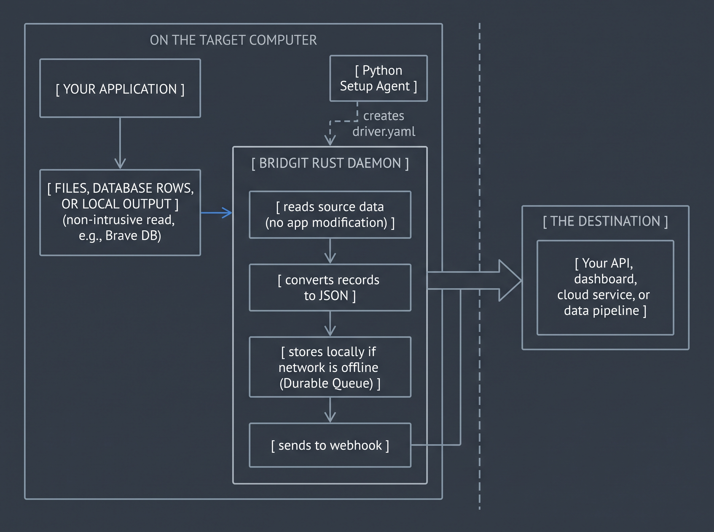

# Bridgit

## Turn any app into an API

Bridgit turns the data produced by desktop applications into modern API
streams—without rewriting or modifying the original app.

If an application writes data to a file, database, export folder, print spool,
or another readable output, Bridgit can capture it, convert it to structured
JSON, and send it to your webhook or service.

That means old Windows software, accounting tools, diagnostic systems,
warehouse programs, and isolated hardware controllers can become usable data
sources for modern applications.

## What Bridgit can connect

- Binary files such as `.dat` files and application exports
- SQLite databases such as GnuCash, Edge, and Brave history databases
- Locked SQLite databases using safe snapshots or sidecar copies
- Programs that continuously create files in an output directory
- Executables and DLLs as sources of information about file formats and data

An executable is usually not the data stream itself. Bridgit examines it to
help identify where the application writes data, then uses a supported,
read-only output route at runtime.

## How it works



The diagram shows the complete flow: your application produces local data,
the Python setup tools create a driver, and the Rust daemon reads, formats,
stores, and sends that data to your destination.

The Python setup tools help inspect a target and create a `driver.yaml` file.
The Rust daemon uses that file continuously on the target computer.

## Project status

The current runtime supports:

- File watchers for binary output files
- Read-only SQLite polling
- Locked SQLite monitoring through snapshots or safe sidecar copies
- Durable local delivery queues with retry support
- Webhook delivery using HTTP POST
- Automatic per-driver queue and checkpoint storage

More source types can be added as separate interceptors without changing the
rest of the pipeline.

## Quick start on Windows

Open PowerShell in the Bridgit folder.

### 1. Install the setup tools

The Python setup layer requires Python 3.10 or newer and PyYAML:

```powershell
python -m pip install pyyaml
$env:PYTHONPATH = ".\agent"
```

The runtime requires Rust and Cargo.

### 2. Inspect a folder

```powershell
python -m bridgit_agent.setup inspect `
  --target "C:\Path\To\Your\Application"
```

The shorter guided command is also available:

```powershell
python -m bridgit_agent.setup sources `
  --target "C:\Path\To\Your\Application"
```

If Rizin is installed, optional binary information can be collected too:

```powershell
$env:BRIDGIT_RZ_BIN = "C:\Path\To\rz-bin.exe"

python -m bridgit_agent.setup inspect `
  --target "C:\Path\To\Your\Application" `
  --analyze-binaries
```

### 3. Create a driver

For a SQLite database, Bridgit can list its tables and let you choose what to
publish:

```powershell
python -m bridgit_agent.setup configure `
  --database "C:\Path\To\data.db" `
  --output ".\drivers\generated\my_driver.yaml"
```

The same action can be written as `create`:

```powershell
python -m bridgit_agent.setup create `
  --database "C:\Path\To\data.db" `
  --output ".\drivers\generated\my_driver.yaml"
```

For a database that stays open and locked by another program, add `--snapshot`:

```powershell
python -m bridgit_agent.setup configure `
  --database "C:\Path\To\History" `
  --output ".\drivers\generated\history_driver.yaml" `
  --snapshot
```

To choose defaults without prompts, add `--auto`.

### 4. Check the driver

```powershell
python -m bridgit_agent.setup validate `
  --driver ".\drivers\generated\my_driver.yaml"

python -m bridgit_agent.setup preview `
  --driver ".\drivers\generated\my_driver.yaml"
```

Or run both checks together:

```powershell
python -m bridgit_agent.setup test `
  --driver ".\drivers\generated\my_driver.yaml"
```

`preview` reads a few records without sending them anywhere.

### 5. Start a webhook receiver

Your API must provide an HTTP endpoint matching the driver configuration. For
a simple local test, save this as `examples/webhook_receiver.py`:

```python
from http.server import BaseHTTPRequestHandler, HTTPServer


class Receiver(BaseHTTPRequestHandler):
    def do_POST(self):
        size = int(self.headers.get("Content-Length", "0"))
        body = self.rfile.read(size)
        print("Received:", body.decode("utf-8", errors="replace"))
        self.send_response(200)
        self.end_headers()


HTTPServer(("127.0.0.1", 8080), Receiver).serve_forever()
```

Run it in one PowerShell window:

```powershell
python .\examples\webhook_receiver.py
```

### 6. Start Bridgit

Run the daemon in another PowerShell window:

```powershell
cargo run --manifest-path .\daemon\Cargo.toml -- `
  --driver .\drivers\generated\my_driver.yaml
```

After building the daemon once, the shorter setup command can start it for
you:

```powershell
python -m bridgit_agent.setup run `
  --driver ".\drivers\generated\my_driver.yaml"
```

To check a running bridge or inspect recent delivery problems:

```powershell
python -m bridgit_agent.setup status `
  --driver ".\drivers\generated\my_driver.yaml"

python -m bridgit_agent.setup logs `
  --driver ".\drivers\generated\my_driver.yaml"
```

The status includes queued, in-progress, and acknowledged record counts.

To create a contract for Postman, FastAPI, Zapier, or another API tool:

```powershell
python -m bridgit_agent.setup export-schema `
  --driver ".\drivers\generated\my_driver.yaml" `
  --output ".\contracts\my_driver.schema.json"

python -m bridgit_agent.setup export-schema `
  --driver ".\drivers\generated\my_driver.yaml" `
  --format openapi `
  --output ".\contracts\my_driver.openapi.yaml"
```

The daemon prints the queue directory it selected. Each driver receives its
own queue, so records from separate applications do not get mixed together.

## When an application is using its files

Some applications keep their files busy while they are running. Bridgit can
use a safe temporary copy of the data instead, allowing the original
application to continue working normally.

This is useful for browsers, accounting software, and other programs that
constantly update their local data. Bridgit can only read information that the
application has already saved.

## Delivery and recovery

Before a record is sent over the network, Bridgit writes it to a local durable
queue. If the webhook is unavailable, the record remains queued and is retried.

This means:

- Temporary network outages do not immediately lose records
- Restarting the daemon can recover pending records
- A successful HTTP response acknowledges a record
- Delivery is at-least-once, so your API should use the record ID for
  deduplication when duplicate delivery matters

## Driver files

A driver describes three things:

```yaml
interceptor:       # where Bridgit reads data
schema:            # which fields or columns to publish
exporter:          # where Bridgit sends JSON
```

Example SQLite driver:

```yaml
metadata:
  name: Example database
  version: 1.0.0

interceptor:
  type: sqlite
  path: C:\data\app.db
  poll_interval_ms: 1000
  read_only: true

schema:
  table: events
  columns: [id, created_at, payload]
  primary_key: id
  query: SELECT "id", "created_at", "payload" FROM "events"

exporter:
  type: webhook
  endpoint: http://127.0.0.1:8080/ingest
  method: POST
```

## Repository layout

```text
bridgit/
├── agent/                    Python setup and inspection tools
│   ├── bridgit_agent/         Setup package
│   └── tests/                 Python tests
├── daemon/                   Rust runtime daemon
│   └── src/                  Interceptors, queue, snapshots, exporter
├── drivers/
│   ├── templates/             Example driver files
│   └── generated/             Drivers created for local testing
├── examples/                 Mock application and test helpers
└── README.md
```

Runtime queues, checkpoints, and snapshots are generated locally and should
not be committed as source files.

## Development checks

```powershell
$env:PYTHONPATH = ".\agent"
python -m pytest -q

cargo fmt --manifest-path .\daemon\Cargo.toml
cargo check --manifest-path .\daemon\Cargo.toml
```

## Important limitations

Bridgit cannot guarantee access to data that an application never writes to
disk or exposes through an external output. Encrypted, proprietary, or heavily
obfuscated formats may also require a custom parser and human investigation.

Always test a driver with representative data before using it for important
business, medical, financial, or industrial workflows.
